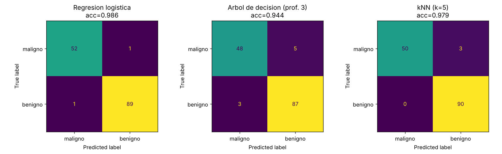
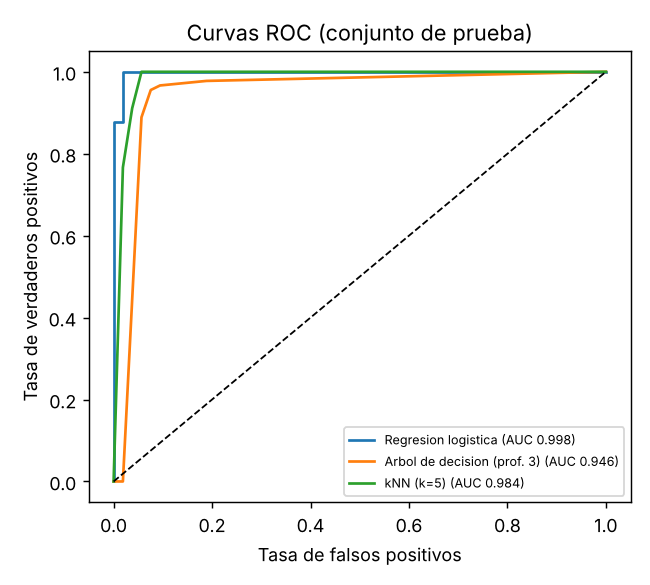
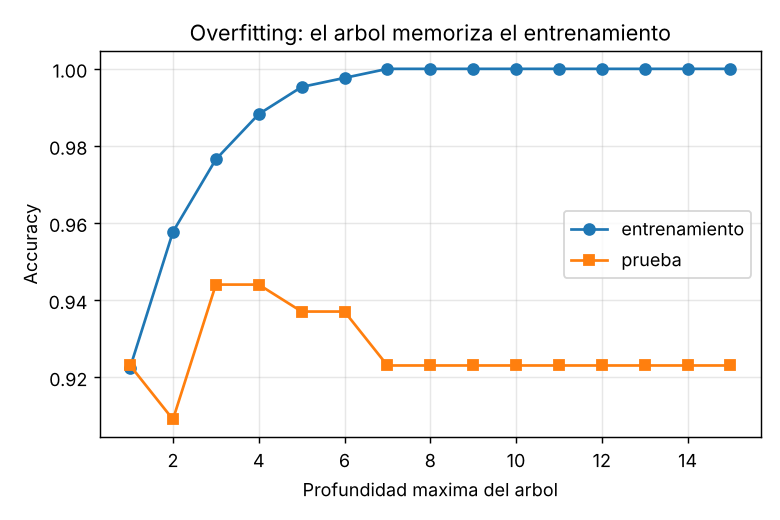

# Mini-proyecto de ML: clasificación de tumores (benigno / maligno)

Artefacto del **Corte 2 (Aprendizaje Automático)** para el portafolio de competencias.

> **Transparencia:** este proyecto fue **construido con ayuda de una IA (Claude)** durante la preparación del portafolio, porque el repositorio no tenía un trabajo del Corte 2. El código es reproducible y los resultados de abajo salen de ejecutarlo, pero conviene que lo leas y lo entiendas antes de defenderlo.

- **Datos:** Breast Cancer Wisconsin (`sklearn.datasets.load_breast_cancer`): 569 casos, 30 variables, 212 malignos y 357 benignos.
- **Modelos:** regresión logística, árbol de decisión (profundidad 3) y kNN (k=5).
- **Evaluación:** validación cruzada de 5 particiones, matriz de confusión, curva ROC/AUC y una demostración de overfitting.

```bash
pip install scikit-learn matplotlib
python3 clasificacion_cancer.py   # regenera figuras/ y resultados.md
```

## Resultados

| Modelo | CV 5-fold | Accuracy test | AUC test |
|---|---|---|---|
| Regresión logística | 0.979 ± 0.009 | 0.986 | 0.998 |
| Árbol de decisión (prof. 3) | 0.939 ± 0.022 | 0.944 | 0.946 |
| kNN (k=5) | 0.967 ± 0.014 | 0.979 | 0.984 |





**Lectura:** en este problema el modelo lineal fue el mejor y el más simple. El árbol llega a 100 % en entrenamiento desde la profundidad 8 pero queda en 92 % en prueba: eso es overfitting. En diagnóstico médico el error que más duele es el **falso negativo** (maligno clasificado como benigno); la regresión logística cometió 1 en 143 casos de prueba. La exactitud sola no basta: hay que mirar qué tipo de error se comete.
