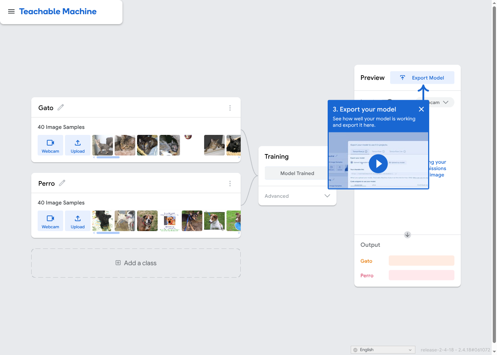
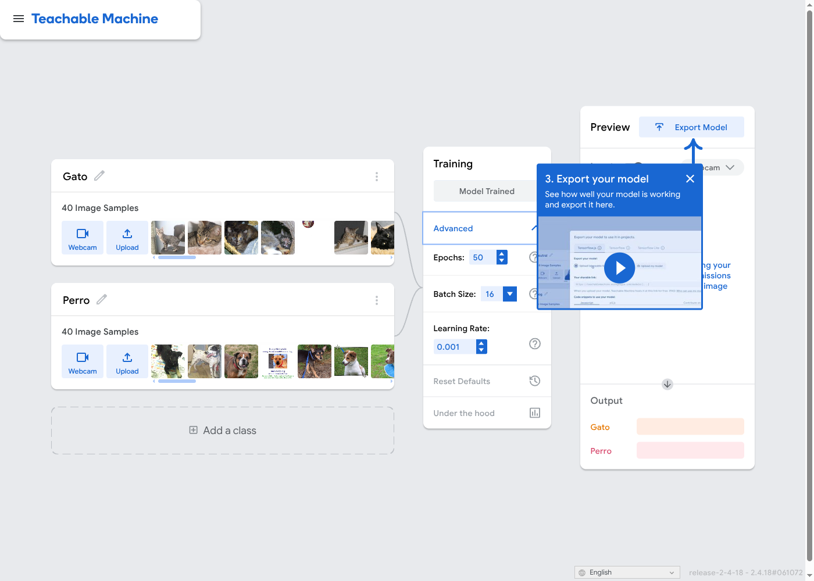
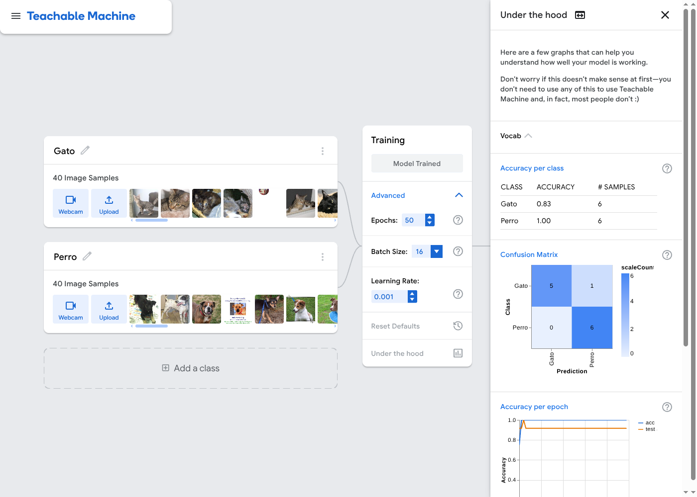
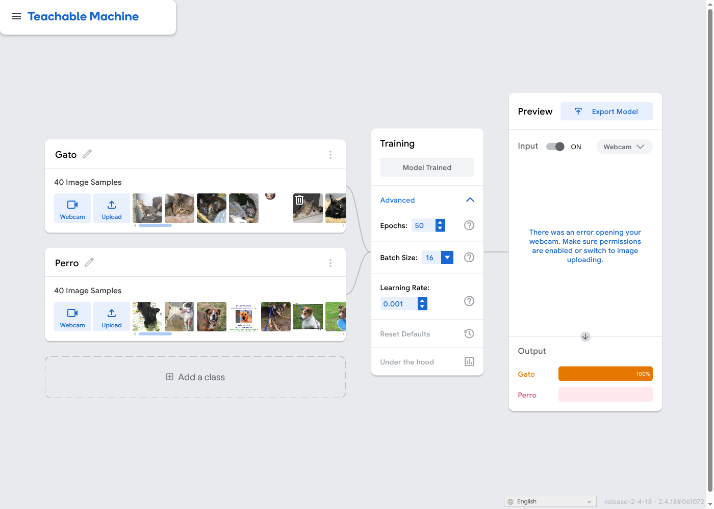
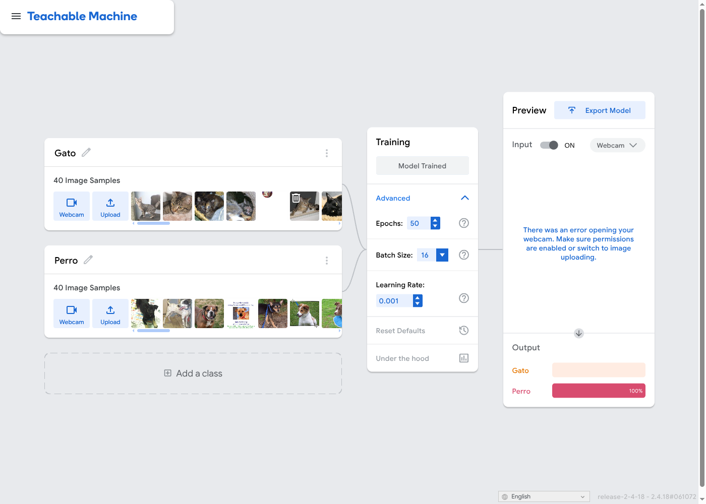
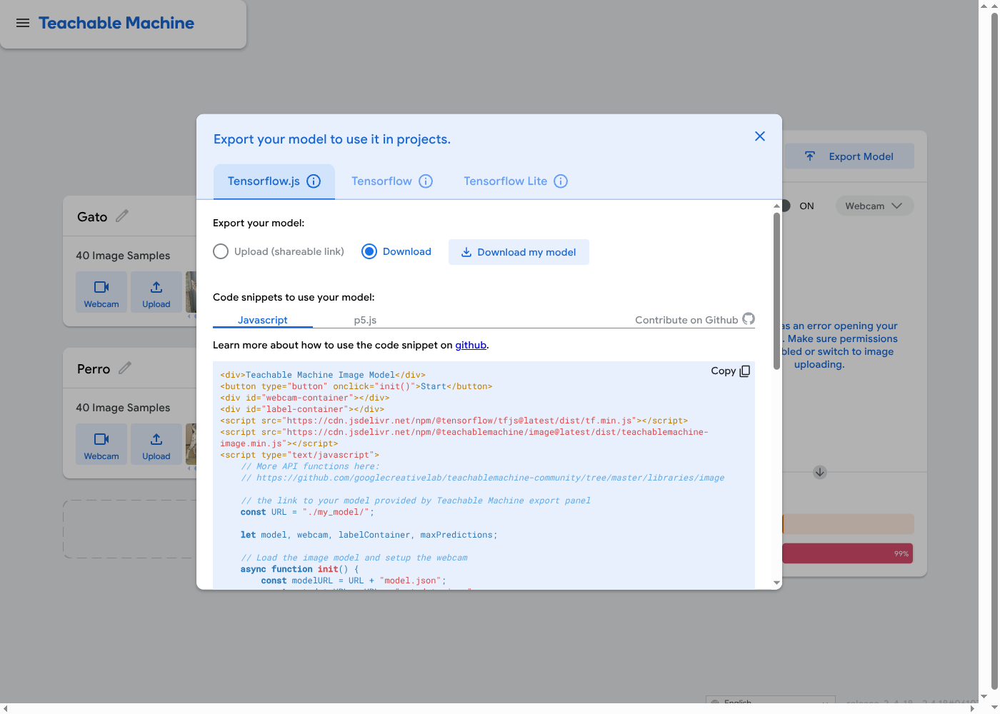
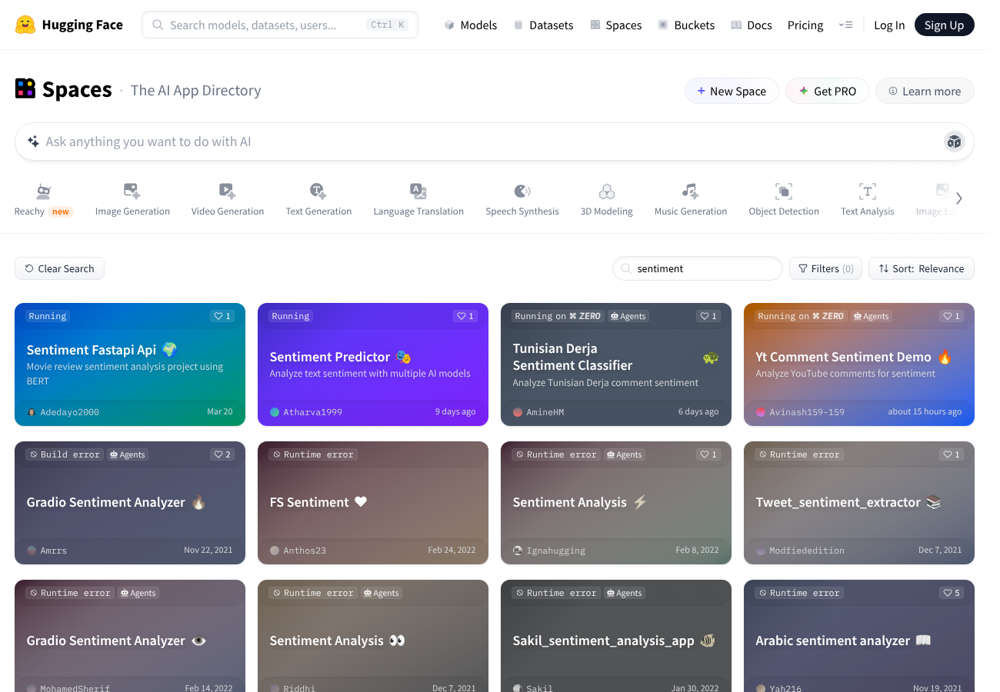
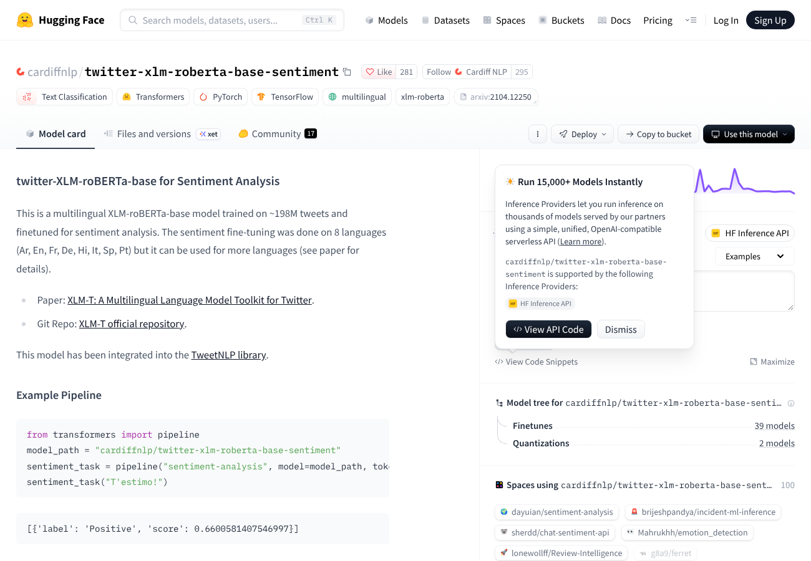
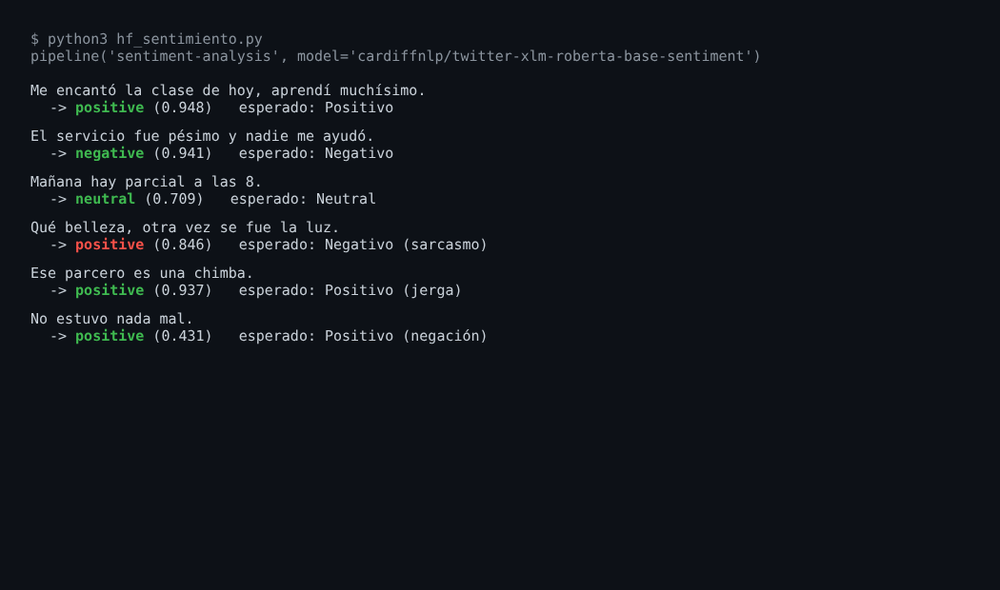

# Exploración de herramientas de IA para principiantes

**Autor:** Andrés Felipe Bolívar Arias
**Curso:** Principios de Inteligencia Artificial 2026-B, Corte 3, semana 4 (semana 14 del semestre)
**Entrega:** individual, en el fork del repositorio de la clase

Herramientas comparadas:

1. **Google Teachable Machine** para hacer un clasificador de imágenes.
2. **Hugging Face (Hub + Spaces)** para usar un analizador de sentimiento de texto con un modelo pre-entrenado.

## Contenido de la carpeta

| Ruta | Descripción |
|---|---|
| `README.md` | Informe completo (este archivo). |
| `capturas/teachable-machine/` | 8 capturas del proceso y resultado del prototipo 1. |
| `capturas/hugging-face/` | 3 capturas del prototipo 2. |
| `modelo-exportado/` | Modelo exportado de Teachable Machine (TensorFlow.js): `model.json`, `weights.bin`, `metadata.json`. |
| `imagenes-prueba/` | Las 10 fotos que el modelo nunca vio durante el entrenamiento. |
| `codigo/hf_sentimiento.py` | Script que ejecuta el modelo de Hugging Face sobre las 6 frases. |
| `codigo/resultados_prueba_teachable_machine.txt` | Confianza (Gato %, Perro %) de cada una de las 10 pruebas. |

---

## 1. Exploración: descripción de las herramientas

### 1.1 Google Teachable Machine

- **Qué hace:** sirve para entrenar en el navegador, sin programar, un modelo que clasifica **imágenes**, **sonidos** o **poses corporales**. El usuario crea las clases (por ejemplo "Pulgar arriba" y "Pulgar abajo"), carga ejemplos con la cámara o con archivos, presiona *Train Model* y prueba el modelo en vivo. El modelo se puede exportar a TensorFlow.js, TensorFlow Lite o Keras.
- **A quién va dirigida:** estudiantes, docentes, artistas y personas que no programan y quieren entender cómo un modelo aprende de ejemplos. También se usa para prototipos rápidos.
- **Tipo de modelo:** una **red neuronal convolucional (CNN)**. Para imágenes usa **MobileNet** (pre-entrenada con ImageNet) como extractor de características y aplica **transfer learning**: congela la base y solo entrena una pequeña cabeza densa con los ejemplos del usuario. Todo corre localmente con **TensorFlow.js**, así que las imágenes no salen del navegador mientras no se guarde el proyecto en Drive.

### 1.2 Hugging Face (Spaces + Model Hub)

- **Qué hace:** Hugging Face es una plataforma que aloja miles de **modelos pre-entrenados** (texto, imagen, audio) y datasets. Los **Spaces** son demos web (hechas con Gradio o Streamlit) donde cualquiera puede probar un modelo escribiendo texto o subiendo un archivo. La página de cada modelo tiene además un *widget* de **inference** para probarlo sin código.
- **A quién va dirigida:** tiene dos niveles. Un principiante solo prueba las demos (no-code). Desarrolladores e investigadores descargan los modelos con la librería `transformers`, les hacen **fine-tuning** y publican sus propios Spaces.
- **Tipo de modelo:** depende del modelo elegido. Para este prototipo se usa un modelo de **análisis de sentimiento** basado en **Transformers** (arquitectura tipo RoBERTa/BERT, multilingüe). Fue pre-entrenado con grandes corpus de texto y luego afinado (*fine-tuned*) para clasificar textos como positivo, neutral o negativo. Aquí el usuario **no entrena nada**: solo hace inferencia.

---

## 2. Práctica: mini-prototipos

> **Nota de transparencia sobre el entorno.** Esta práctica se ejecutó en un entorno en la nube **sin cámara web**. Por eso el prototipo 1 no usa gestos con la webcam: usa fotos de gatos y perros subidas con el botón *Upload* de Teachable Machine. Las fotos provienen del dataset público [`microsoft/cats_vs_dogs`](https://huggingface.co/datasets/microsoft/cats_vs_dogs). En la vista previa de las capturas 06 y 07 se ve el aviso "error opening your webcam" por la misma razón; las barras de *Output* sí corresponden a la foto subida. Teachable Machine se manejó con un navegador automatizado (Playwright), con los mismos pasos que haría una persona.

### 2.1 Prototipo 1: clasificador de imágenes Gato vs. Perro (Teachable Machine)

**Objetivo:** clasificar una foto como `Gato` o `Perro`.

**Pasos realizados:**

1. Abrir <https://teachablemachine.withgoogle.com/train/image> (*Image Project → Standard image model*).
2. Renombrar las dos clases a `Gato` y `Perro`.
3. Subir **40 fotos por clase** con *Upload* (80 en total). Teachable Machine separa por su cuenta el 15 % para validación (6 por clase).
4. Presionar **Train Model** con la configuración por defecto: 50 épocas, *batch size* 16, *learning rate* 0.001.
5. Abrir *Advanced → Under the hood* para ver la precisión por clase y la matriz de confusión.
6. Probar el modelo con las **10 fotos nuevas** de `imagenes-prueba/` (5 gatos y 5 perros que no estaban en el entrenamiento).
7. **Export Model → TensorFlow.js → Download** y guardar los archivos en `modelo-exportado/`.

**Evidencia:**

| Paso | Captura |
|---|---|
| Clases renombradas |  |
| 40 muestras por clase cargadas |  |
| Modelo entrenado ("Model Trained") |  |
| Parámetros de entrenamiento |  |
| Precisión por clase y matriz de confusión |  |
| Predicción con foto nueva de gato |  |
| Predicción con foto nueva de perro |  |
| Exportación del modelo |  |

**Resultados observados:**

| Evaluación | Resultado |
|---|---|
| Precisión por clase (validación de TM, 6 fotos por clase) | Gato **0.83**, Perro **1.00** |
| Matriz de confusión (validación) | 5 gatos bien, **1 gato clasificado como perro**, 6 perros bien |
| 10 fotos nuevas (`imagenes-prueba/`) | **10 de 10 correctas**; la confianza fue 100 % en todas (ver `codigo/resultados_prueba_teachable_machine.txt`) |

Lectura de los resultados: la validación interna es muy pequeña (12 fotos), por lo que un solo error mueve la precisión de Gato a 0.83. Las 10 fotos nuevas salieron perfectas, pero son pocas y de buena calidad, así que **no demuestran que el modelo generalice bien**. Una confianza del 100 % en todas las pruebas también sugiere que el modelo está muy seguro aun cuando tiene pocos datos, algo que conviene no tomar al pie de la letra.

### 2.2 Prototipo 2: analizador de sentimiento con Hugging Face

**Objetivo:** clasificar frases en español como positivas, neutrales o negativas con un modelo pre-entrenado, **sin entrenar nada** (solo inferencia).

**Modelo:** [`cardiffnlp/twitter-xlm-roberta-base-sentiment`](https://huggingface.co/cardiffnlp/twitter-xlm-roberta-base-sentiment). Según su *Model Card*, es un XLM-RoBERTa-base multilingüe entrenado con unos 198 millones de tweets y ajustado (*fine-tuned*) para sentimiento en 8 idiomas (árabe, inglés, francés, alemán, hindi, italiano, español y portugués).

**Pasos realizados:**

1. Buscar `sentiment` en Hugging Face Spaces y abrir la página del modelo para leer su *Model Card*.
2. Ejecutar el modelo con la librería `transformers` (`pipeline("sentiment-analysis", ...)`), que es el mismo modelo que usan el widget y los Spaces. El script está en `codigo/hf_sentimiento.py`.
3. Probar 6 frases, incluidos casos difíciles (sarcasmo, jerga colombiana y negación).

**Resultados reales:**

| # | Frase | Esperado | Predicción del modelo | Confianza | ¿Acertó? |
|---|---|---|---|---|---|
| 1 | "Me encantó la clase de hoy, aprendí muchísimo." | Positivo | positive | 0.948 | Sí |
| 2 | "El servicio fue pésimo y nadie me ayudó." | Negativo | negative | 0.941 | Sí |
| 3 | "Mañana hay parcial a las 8." | Neutral | neutral | 0.709 | Sí |
| 4 | "Qué belleza, otra vez se fue la luz." (sarcasmo) | Negativo | **positive** | 0.846 | **No** |
| 5 | "Ese parcero es una chimba." (jerga) | Positivo | positive | 0.937 | Sí |
| 6 | "No estuvo nada mal." (negación) | Positivo | positive | 0.431 | Sí, pero con baja confianza |

Acertó **5 de 6**. La falla clara es el sarcasmo (caso 4), y además lo clasificó como positivo con una confianza alta (0.846).

**Evidencia:**

| Paso | Captura |
|---|---|
| Búsqueda en Hugging Face Spaces |  |
| Página del modelo y su *Model Card* |  |
| Salida de la inferencia sobre las 6 frases |  |

La captura 03 es una imagen generada con la salida real del script (verde = acierto, rojo = fallo). No es una captura de un widget web: la inferencia se corrió localmente porque el servicio de inferencia en línea de Hugging Face no estaba accesible desde este entorno.

---

## 3. Análisis comparativo

| Criterio | Teachable Machine | Hugging Face (Spaces / Hub) |
|---|---|---|
| **Facilidad de uso** | Muy alta. Es 100 % visual y guiada; en unos 10 minutos ya hay un modelo funcionando. No requiere cuenta. | Alta solo para probar demos y widgets. Pasa a media o baja si se quiere hacer fine-tuning o publicar un Space propio, porque eso exige Python, `transformers` y Git. |
| **Tipo de modelo** | CNN (MobileNet) con **transfer learning**: se re-entrena solo la última capa. Clasificación de imagen, sonido o pose. | Modelos **pre-entrenados** de todo tipo. El que se usó aquí es un **Transformer** (XLM-RoBERTa) con fine-tuning para sentimiento. También hay generación de texto, imagen, traducción y más. |
| **Necesidad de datos** | El usuario debe aportar los datos: unos 50-200 ejemplos por clase bastan gracias al transfer learning. La calidad y la diversidad de esos datos determinan el resultado. | Ninguna para inferencia: el modelo ya fue entrenado con millones de textos. Para fine-tuning se necesita un dataset etiquetado (de cientos a miles de ejemplos). |
| **Limitaciones** | Solo clasificación, con pocas clases. Es sensible a la iluminación y al fondo, y generaliza mal fuera de los ejemplos capturados. No reporta métricas sobre un conjunto de prueba independiente. | El usuario no controla los datos de entrenamiento y hereda sus sesgos. Los Spaces gratuitos se "duermen" o van lentos, y muchos modelos funcionan peor en español o con jerga. Las licencias varían de un modelo a otro. |
| **Casos de uso potenciales** | Prototipos educativos, control por gestos, clasificar residuos reciclables, detectar plantas enfermas o productos defectuosos en una línea simple, accesibilidad. | Análisis de opiniones de clientes, chatbots, traducción, resumen de documentos, moderación de comentarios, clasificación de tickets de soporte. |

**Diferencia clave:** en Teachable Machine **el usuario entrena** un modelo pequeño con sus propios datos. En Hugging Face, en el nivel principiante, **el usuario solo consume** un modelo grande que otros entrenaron, es decir, hace inferencia.

---

## 4. Reflexión ética: sesgo y falsa seguridad

**Limitación identificada (observada en el prototipo 2): el modelo falla con el sarcasmo y lo hace con mucha seguridad.**

La frase "Qué belleza, otra vez se fue la luz." es una queja, pero el modelo la clasificó como **positiva con 0.846 de confianza**. Y "No estuvo nada mal." (una valoración positiva por negación) recibió solo 0.431. El modelo se guía por palabras de apariencia positiva ("belleza") y no entiende la intención. Esto se debe a que se entrenó con tweets en idiomas muy distintos: el español colombiano y el tono irónico no son el centro de sus datos. Si una empresa o una universidad usara este modelo para moderar comentarios o medir la satisfacción de estudiantes, **las quejas sarcásticas se contarían como elogios**, y los dialectos o comunidades menos representados en los datos quedarían peor atendidos. El riesgo está en que la herramienta devuelve un número de confianza alto que parece una garantía, aunque se equivoque.

**Observación relacionada en Teachable Machine (prototipo 1):** el modelo dio 100 % de confianza en las 10 pruebas, pero se entrenó con solo 40 fotos por clase, tomadas de un dataset de internet y sin variedad de luz, raza, ángulo o fondos. La herramienta no advierte que esa seguridad no equivale a un buen desempeño en el mundo real. Lo mismo, aplicado a personas (por ejemplo rostros o gestos), discriminaría a quienes no estuvieron en los datos de entrenamiento. Además, la validación interna solo usa 6 fotos por clase, así que la métrica es muy poco fiable.

**Mitigaciones:** leer la *Model Card* antes de usar un modelo; probar con casos difíciles propios de la comunidad de uso (jerga, sarcasmo, otros dialectos); evaluar con un conjunto de prueba más grande y diverso; no interpretar la confianza del modelo como probabilidad de acierto; y mantener una revisión humana cuando se usen estos modelos para decisiones que afecten a personas.

---

## 5. Tool Comparison Summary

Teachable Machine and Hugging Face are both beginner-friendly AI tools, but they take very different approaches to machine learning. Teachable Machine is a fully **no-code** platform where users train their own image, sound or pose classifier directly in the browser by recording a few examples per class. Behind the scenes it relies on **transfer learning**: it reuses a **pre-trained model** (MobileNet) as a feature extractor and only trains a small final layer, which is why a few dozen samples per class are enough. Hugging Face, on the other hand, is a hub of thousands of **pre-trained models** that users can test through Spaces and model widgets, so a beginner mostly performs **inference** on a model that someone else has already trained. More advanced users can download those models with the `transformers` library and apply **fine-tuning** on their own labeled dataset to adapt them to a specific task or language. In terms of data, Teachable Machine requires the user to collect and label every example, whereas Hugging Face requires no data at all for simple inference. Both tools make AI more accessible, but they also hide important details about the training data, so users must stay aware of bias and of the limits of their models.

---

## Referencias

- Google Creative Lab. *Teachable Machine*. <https://teachablemachine.withgoogle.com/>
- Teachable Machine Community (código fuente). <https://github.com/googlecreativelab/teachablemachine-community>
- Hugging Face. *Spaces*. <https://huggingface.co/spaces>
- Barbieri, F., Espinosa-Anke, L., & Camacho-Collados, J. (2022). *XLM-T: Multilingual Language Models in Twitter for Sentiment Analysis and Beyond*. Model card: <https://huggingface.co/cardiffnlp/twitter-xlm-roberta-base-sentiment>
- Mitchell, M. et al. (2019). *Model Cards for Model Reporting*. FAT\* '19.
