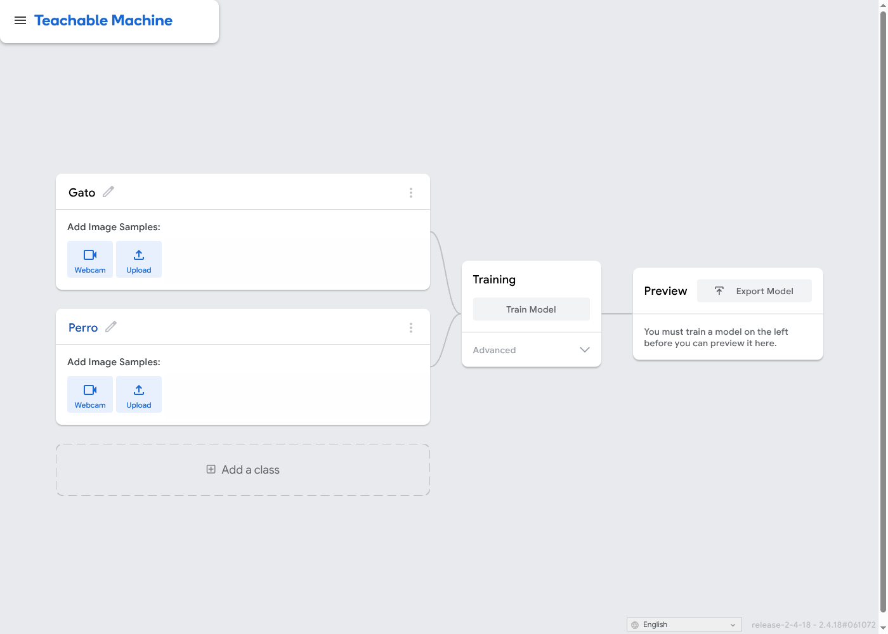
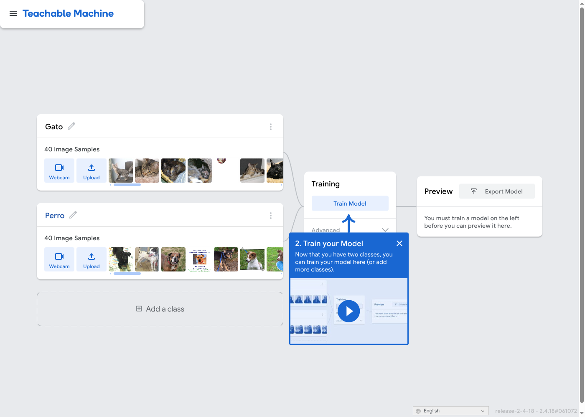

# Exploración de herramientas de IA para principiantes

**Autor:** Andrés Felipe Bolívar Arias
**Curso:** Principios de Inteligencia Artificial 2026-B, Corte 3, semana 4 (semana 14 del semestre)
**Entrega:** individual, en el fork del repositorio de la clase

Herramientas comparadas:

1. **Google Teachable Machine** para hacer un clasificador de imágenes.
2. **Hugging Face Spaces / Hub** para usar un analizador de sentimiento de texto con un modelo pre-entrenado.

## Contenido de la carpeta

| Ruta | Descripción |
|---|---|
| `README.md` | Informe completo (este archivo). |
| `capturas/teachable-machine/` | Capturas del proceso y del resultado del prototipo 1. |
| `capturas/hugging-face/` | Capturas del proceso y del resultado del prototipo 2. |
| `modelo-exportado/` | Modelo exportado desde Teachable Machine (`model.json`, `weights.bin`, `metadata.json`). |

---

## 1. Exploración: descripción de las herramientas

### 1.1 Google Teachable Machine

- **Qué hace:** sirve para entrenar en el navegador, sin programar, un modelo que clasifica **imágenes**, **sonidos** o **poses corporales**. El usuario crea las clases (por ejemplo "Pulgar arriba" y "Pulgar abajo"), carga ejemplos con la cámara o con archivos, presiona *Train Model* y prueba el modelo en vivo. El modelo se puede exportar a TensorFlow.js, TensorFlow Lite o Keras.
- **A quién va dirigida:** estudiantes, docentes, artistas y personas que no programan y quieren entender cómo un modelo aprende de ejemplos. También se usa para prototipos rápidos.
- **Tipo de modelo:** una **red neuronal convolucional (CNN)**. Para imágenes usa **MobileNet** (pre-entrenada con ImageNet) como extractor de características y aplica **transfer learning**: congela la base y solo entrena una pequeña cabeza densa con los ejemplos del usuario. Todo corre localmente con **TensorFlow.js**, así que las imágenes no salen del navegador mientras no se guarde el proyecto en Drive.

### 1.2 Hugging Face (Spaces + Model Hub)

- **Qué hace:** Hugging Face es una plataforma que aloja miles de **modelos pre-entrenados** (texto, imagen, audio) y datasets. Los **Spaces** son demos web (hechas con Gradio o Streamlit) donde cualquiera puede probar un modelo escribiendo texto o subiendo un archivo. La página de cada modelo tiene además un *widget* de **inference** para probarlo sin código.
- **A quién va dirigida:** tiene dos niveles. Un principiante solo prueba las demos (no-code). Desarrolladores e investigadores descargan los modelos con la librería `transformers`, les hacen **fine-tuning** y publican sus propios Spaces.
- **Tipo de modelo:** depende del modelo elegido. Para este prototipo se usa un modelo de **análisis de sentimiento** basado en **Transformers** (arquitectura tipo RoBERTa/BERT, multilingüe). Fue pre-entrenado con grandes corpus de texto y luego afinado (*fine-tuned*) para clasificar textos como positivo, neutral o negativo. Aquí el usuario **no entrena nada**: solo hace inferencia.

---

## 2. Práctica: mini-prototipos

### 2.1 Prototipo 1: clasificador de gestos con Teachable Machine

**Objetivo:** clasificar con la cámara web tres clases: `Pulgar arriba`, `Pulgar abajo` y `Fondo` (sin mano).

**Pasos realizados:**

1. Entrar a <https://teachablemachine.withgoogle.com/train> → *Image Project* → *Standard image model*.
2. Renombrar las clases: `Pulgar arriba`, `Pulgar abajo`, `Fondo`.
3. Capturar con *Webcam → Hold to Record* unas 150 imágenes por clase, variando la distancia, el ángulo y la mano.
4. Presionar **Train Model** (configuración por defecto: 50 épocas, *batch size* 16, *learning rate* 0.001).
5. Probar en la vista *Preview* con gestos nuevos y revisar *Advanced → Under the hood* (accuracy por clase y matriz de confusión).
6. Exportar con **Export Model → TensorFlow.js → Download** y guardar los archivos en `modelo-exportado/`.

**Evidencia:**

| Paso | Captura |
|---|---|
| Proyecto creado y clases definidas |  |
| Muestras cargadas por clase |  |
| Entrenamiento |  |
| Resultado: predicción "Pulgar arriba" |  |
| Resultado: predicción "Pulgar abajo" |  |
| Accuracy por clase / matriz de confusión |  |
| Exportación del modelo |  |

**Resultados observados:** _(completar con lo que viste)_

- Accuracy por clase: Pulgar arriba ___ %, Pulgar abajo ___ %, Fondo ___ %.
- El modelo falla cuando: _(por ejemplo, con otra iluminación, otra persona o la mano de lado)_.

### 2.2 Prototipo 2: analizador de sentimiento con Hugging Face

**Objetivo:** clasificar frases en español como **positivas, neutrales o negativas** usando un modelo pre-entrenado, sin entrenar nada.

**Pasos realizados:**

1. Entrar a <https://huggingface.co/spaces> y buscar `sentiment analysis`, o abrir directamente la página del modelo `cardiffnlp/twitter-xlm-roberta-base-sentiment` (multilingüe), que tiene un *widget* de inferencia.
2. Leer la *Model Card*: arquitectura (XLM-RoBERTa), datos de entrenamiento (tweets en varios idiomas) y limitaciones.
3. Escribir frases de prueba y anotar la etiqueta y la confianza que devuelve el modelo.
4. Probar casos difíciles: sarcasmo, jerga colombiana y negaciones.

**Frases de prueba y resultados:** _(completar con lo que devolvió el modelo)_

| # | Frase | Esperado | Predicción del modelo | Confianza |
|---|---|---|---|---|
| 1 | "Me encantó la clase de hoy, aprendí muchísimo." | Positivo | | |
| 2 | "El servicio fue pésimo y nadie me ayudó." | Negativo | | |
| 3 | "Mañana hay parcial a las 8." | Neutral | | |
| 4 | "Qué belleza, otra vez se fue la luz." (sarcasmo) | Negativo | | |
| 5 | "Ese parcero es una chimba." (jerga) | Positivo | | |
| 6 | "No estuvo nada mal." (negación) | Positivo | | |

**Evidencia:**

| Paso | Captura |
|---|---|
| Página del Space / modelo y su Model Card |  |
| Frase positiva |  |
| Frase negativa |  |
| Caso difícil (sarcasmo / jerga) |  |

---

## 3. Análisis comparativo

| Criterio | Teachable Machine | Hugging Face (Spaces / Hub) |
|---|---|---|
| **Facilidad de uso** | Muy alta. Es 100 % visual y guiada; en unos 10 minutos ya hay un modelo funcionando. No requiere cuenta. | Alta solo para probar demos y widgets. Pasa a media o baja si se quiere hacer fine-tuning o publicar un Space propio, porque eso exige Python, `transformers` y Git. |
| **Tipo de modelo** | CNN (MobileNet) con **transfer learning**: se re-entrena solo la última capa. Clasificación de imagen, sonido o pose. | Modelos **pre-entrenados** de todo tipo. El que se usó aquí es un **Transformer** (XLM-RoBERTa) con fine-tuning para sentimiento. También hay generación de texto, imagen, traducción y más. |
| **Necesidad de datos** | El usuario debe aportar los datos: unos 50-200 ejemplos por clase bastan gracias al transfer learning. La calidad y la diversidad de esos datos determinan el resultado. | Ninguna para inferencia: el modelo ya fue entrenado con millones de textos. Para fine-tuning se necesita un dataset etiquetado (de cientos a miles de ejemplos). |
| **Limitaciones** | Solo clasificación, con pocas clases. Es sensible a la iluminación y al fondo, y generaliza mal fuera de los ejemplos capturados. No reporta métricas sobre un conjunto de prueba independiente. | El usuario no controla los datos de entrenamiento y hereda sus sesgos. Los Spaces gratuitos se "duermen" o van lentos, y muchos modelos funcionan peor en español o con jerga. Las licencias varían de un modelo a otro. |
| **Casos de uso potenciales** | Prototipos educativos, control por gestos, clasificar residuos reciclables, detectar plantas enfermas o productos defectuosos en una línea simple, accesibilidad. | Análisis de opiniones de clientes, chatbots, traducción, resumen de documentos, moderación de comentarios, clasificación de tickets de soporte. |

**Diferencia clave:** en Teachable Machine **el usuario entrena** un modelo pequeño con sus propios datos. En Hugging Face, en el nivel principiante, **el usuario solo consume** un modelo grande que otros entrenaron, es decir, hace inferencia.

---

## 4. Reflexión ética: sesgo en los datos

**Limitación identificada: el sesgo de representación en Teachable Machine (y el sesgo heredado en Hugging Face).**

En Teachable Machine el modelo solo "conoce" lo que se le mostró. Si todas las muestras de "Pulgar arriba" se graban con **una sola mano, un solo tono de piel, la misma luz y el mismo fondo**, el modelo puede aprender atajos: por ejemplo, el color del fondo o de la piel en lugar de la forma del gesto. Al probarlo con otra persona, sobre todo con un tono de piel distinto o con poca luz, la confianza baja o la predicción falla. En un juego no pasa nada grave, pero el mismo mecanismo en un sistema de acceso, de vigilancia o de diagnóstico médico **discriminaría a los grupos que no estuvieron en los datos de entrenamiento**. La herramienta no advierte de esto, y su facilidad de uso puede dar una falsa sensación de que el modelo "funciona" porque obtiene un 100 % de accuracy sobre los mismos datos con los que se entrenó.

En Hugging Face el problema cambia de forma: el usuario **hereda sesgos que no puede ver**. Un modelo de sentimiento entrenado mayormente con tweets en inglés o en español "estándar" puede clasificar como negativas expresiones colombianas positivas ("una chimba") o no detectar el sarcasmo. Si ese modelo se usa para moderar comentarios o evaluar clientes, ciertos dialectos y comunidades quedan perjudicados de forma sistemática.

**Mitigaciones:** recoger datos diversos (personas, luz, fondos), evaluar con un conjunto de prueba separado y con personas que no participaron en el entrenamiento, leer la *Model Card* antes de usar un modelo y documentar para qué **no** debe usarse el prototipo.

---

## 5. Tool Comparison Summary

Teachable Machine and Hugging Face are both beginner-friendly AI tools, but they take very different approaches to machine learning. Teachable Machine is a fully **no-code** platform where users train their own image, sound or pose classifier directly in the browser by recording a few examples per class. Behind the scenes it relies on **transfer learning**: it reuses a **pre-trained model** (MobileNet) as a feature extractor and only trains a small final layer, which is why a few dozen samples per class are enough. Hugging Face, on the other hand, is a hub of thousands of **pre-trained models** that users can test through Spaces and model widgets, so a beginner mostly performs **inference** on a model that someone else has already trained. More advanced users can download those models with the `transformers` library and apply **fine-tuning** on their own labeled dataset to adapt them to a specific task or language. In terms of data, Teachable Machine requires the user to collect and label every example, whereas Hugging Face requires no data at all for simple inference. Both tools make AI more accessible, but they also hide important details about the training data, so users must stay aware of bias and of the limits of their models.

---

## Referencias

- Google Creative Lab. *Teachable Machine*. <https://teachablemachine.withgoogle.com/>
- Teachable Machine Community (código fuente). <https://github.com/googlecreativelab/teachablemachine-community>
- Hugging Face. *Spaces*. <https://huggingface.co/spaces>
- Barbieri, F., Espinosa-Anke, L., & Camacho-Collados, J. (2022). *XLM-T: Multilingual Language Models in Twitter for Sentiment Analysis and Beyond*. Model card: <https://huggingface.co/cardiffnlp/twitter-xlm-roberta-base-sentiment>
- Mitchell, M. et al. (2019). *Model Cards for Model Reporting*. FAT\* '19.
